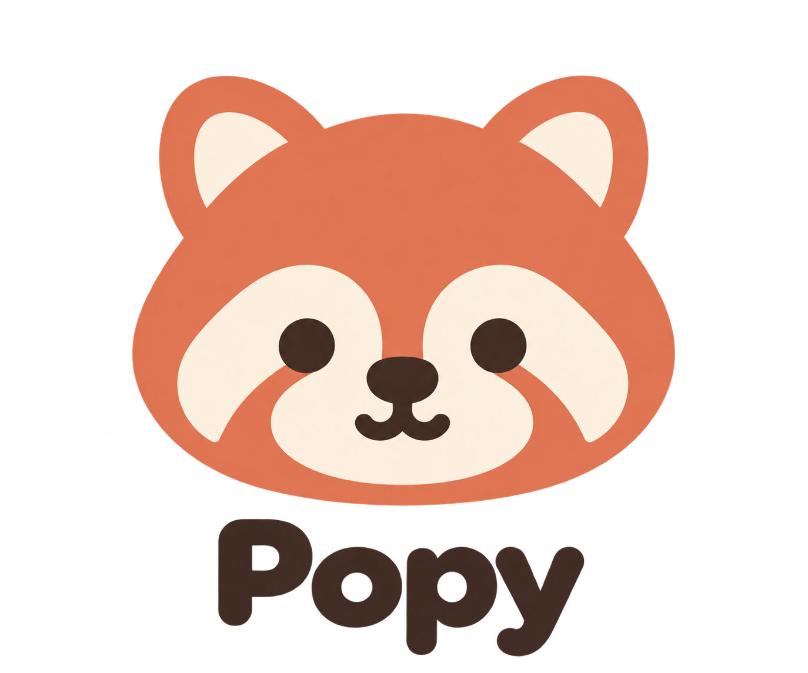
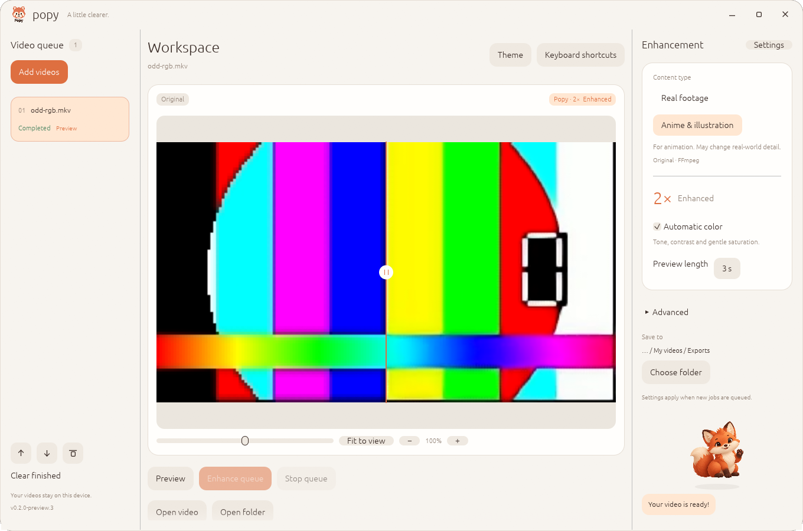
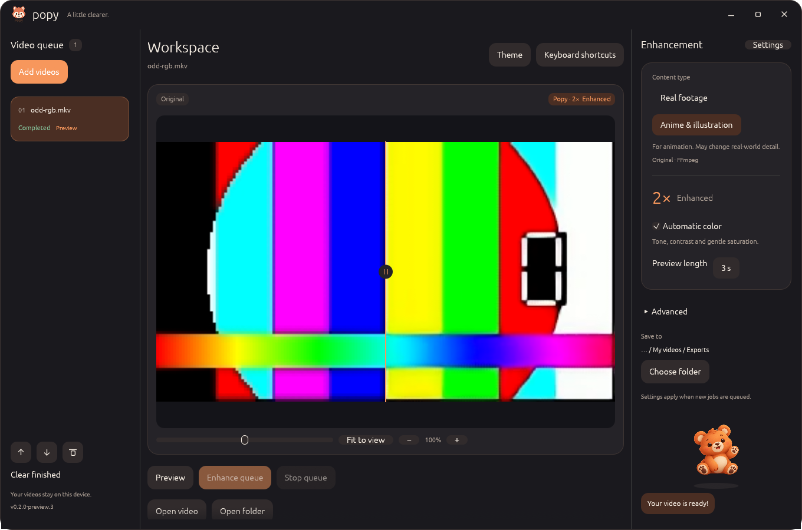

<p align="center">
  
</p>

# Popy

**Biraz daha net. Biraz daha senin.**

Popy, bilgisayarında çalışan açık kaynak bir video iyileştirme uygulamasıdır. Videonu büyüt, rengini ayarla, sonucu karşılaştır ve kuyruğunu sade bir çalışma alanından yönet. Bir tilki ya da ayı sana eşlik etsin; fareyi, klavyeyi ve arayüzü istediğin gibi kullan.

[Windows için indir](https://github.com/boranseasonnew/Popy/releases/download/v0.2.0-preview.2/Popy-0.2.0-preview.2-setup.exe) · [Tüm indirmeler](https://github.com/boranseasonnew/Popy/releases/tag/v0.2.0-preview.2) · [English](README.md) · [Kullanım rehberi](docs/QUICKSTART.tr.md)

[](https://github.com/boranseasonnew/Popy/actions/workflows/check.yml)



<details>
<summary>Ayı eşlikçiyle koyu tema</summary>



</details>

## Neden Popy?

Popy, Adobe ekosistemi dahil ücretli ve kapalı yaratıcı yazılımların maliyetlerinden ve sınırlarından duyduğumuz rahatsızlıkla başladı. Kullanan kişinin cihazını, gizliliğini ve tercihlerini merkeze alan bir araç istedik.

Bunun için yerel çalışan, kaynak kodu incelenebilen ve birlikte geliştirilebilen bir uygulama yapıyoruz. Popy hesap veya abonelik gerektirmez. Videoların bilgisayarında işlenir. Tema, eşlikçi ve kısayollar gibi seçimler de sana aittir.

## Neler yapabilirsin?

- **Desteklenen videoları 2× büyüt:** gerçek çekim veya animasyon için Real-ESRGAN modellerini seç.
- **Otomatik rengi açıp kapat:** ton, kontrast ve hafif doygunluk düzeltmesi uygula.
- **Kısa önizleme al:** ilk kareyi kaydırıcıyla karşılaştır; hareketi değerlendirmek için çıkan videoyu aç.
- **Kuyruğu yönet:** ilerlemeyi izle, durdur, yeniden dene, sıralamayı değiştir ve her işin sonucuna ayrı klasörden ulaş.
- **Çalışma alanını kişiselleştir:** açık/koyu tema, azaltılmış hareket, arayüz boyutu ve tilki/ayı/gizli eşlikçi seçeneklerini kullan.
- **Klavyeyle çalış:** kısayolları Ayarlar'dan yeniden ata.
- **20 arayüz dilinden birini seç:** varsayılan dil İngilizcedir.
- **Uygulama içinden güncelle:** yeni sürümü doğrulanmış paketle indirip kur; GitHub sayfasına gitmen gerekmez.

Otomatik renk, siyah beyaz görüntüye yeni renk ekleme özelliği değildir. Popy mevcut modelleri kullanır; iyileştirme kalitesi kaynağa ve modele göre değişir.

## Başlangıç

1. Windows x64 **Setup EXE** dosyasını indirip kur; taşınabilir kullanım için ZIP'i tamamen çıkar.
2. Popy'yi aç. İlk kullanımda **Set up tools** düğmesine (**F8**) bas veya `Setup Tools.cmd` dosyasını çalıştır.
3. **Ctrl+O** ile video ekle, modelini seç ve **F5** ile önizleme al.
4. **Ctrl+Enter** ile kuyruğu işle. Sonuçlar yeni klasörlere yazılır; kaynak dosyaların korunur.

İlk kurulum FFmpeg, ncnn ve modelleri indirir. Hazır uygulamayı kullanmak için Rust veya Visual Studio gerekmez. Kurulumdan sonra video işleme yereldir; açıkça başlattığın güncelleme kontrolleri ve indirmeler internet kullanır. Dosya sınırları ve sorun giderme için [rehbere](docs/QUICKSTART.tr.md) bak.

| Kısayol | İşlem |
|---|---|
| Ctrl+O | Video ekle |
| F5 | Önizleme oluştur |
| Ctrl+Enter | Kuyruğu işle |
| Ctrl+Shift+X | Kuyruğu durdur |
| Boşluk / B / A | Basılı tutarak kaynak / kaynak / iyileştirilmiş |
| Alt+Sol / Sağ | Video seç |
| Alt+Yukarı / Aşağı | Seçili işi sırala |
| Ctrl+, / F1 | Ayarlar / kısayol düzenleyicisi |
| F6 / Ctrl+B | Tema / eşlikçi değiştir |
| Ctrl+U | Güncellemeleri denetle |

## Diller

English, Türkçe, Azərbaycanca, हिन्दी, Русский, Español, Português, Français, Deutsch, العربية, 简体中文, 日本語, 한국어, Italiano, Nederlands, Polski, Українська, Bahasa Indonesia, Tiếng Việt ve ไทย.

Arayüz çevirileri dahildir; ana dilde inceleme katkılarını bekliyoruz. Yerel dosya pencereleri işletim sisteminin dilini izler, bazı teknik tanılar çevrilmemiş olabilir.

## Mevcut sürüm

**0.2.0-preview.2**, Windows x64 ve Vulkan sürücüsünü hedefler. Progressive H.264, sabit FPS, açık BT.709 SDR renk bilgisi ve isteğe bağlı hizalı AAC ses kabul eder. Çıktı 2×'tir. Genel model girdisi en fazla 960×540, anime modeli girdisi 1920×1080 olabilir.

HDR, VFR, rotasyon, interlaced ve diğer kodek/akış düzenleri geliştirilmeye devam ediyor. Mevcut motor küçük kare grupları ve geçici kayıpsız segmentler kullandığı için uzun videolar disk alanı gerektirir. Doğal video kalitesi, çok saatlik kararlılık ve geniş GPU matrisi hâlâ sürüm kapılarıdır. Yerel GPU testleri AMD Radeon iGPU'da yapıldı; RTX, ayrı AMD ve Intel uyumluluğu sertifikalandırılmadı.

Görseller gerçek uygulama oturumundan alınmıştır. Üretilmiş teknik klipler işleyişi gösterir; doğal görüntüde restorasyon kalitesi kanıtı değildir.

## Geliştirme ve katkı

Popy; Rust, egui/eframe ve ncnn/Vulkan ile geliştiriliyor. Kalite testleri, donanım doğrulaması, çeviri ve kullanılabilirlik katkılarına açığız.

```powershell
.\scripts\bootstrap.ps1
.\scripts\dev.ps1 test
.\scripts\dev.ps1 build --release
```

[Geliştirme durumu](docs/STATUS.md) · [Yol haritası](docs/ROADMAP.md) · [İmzalı güncellemeler](docs/UPDATES.md) · [Benchmark araçları](benchmarks/README.md)

## Lisans ve teşekkür

Popy'nin özgün kodu [Apache-2.0](LICENSE) lisanslıdır. Araçlar, fontlar ve model ağırlıkları kendi [lisanslarına](docs/THIRD_PARTY.md) tabidir.

[Real-ESRGAN](https://github.com/xinntao/Real-ESRGAN), [ncnn](https://github.com/Tencent/ncnn), [FFmpeg](https://ffmpeg.org/) ve [egui](https://github.com/emilk/egui) çalışmalarının üzerine kurulmuştur. Popy bağımsızdır; Adobe veya Topaz Labs ile bağlantısı yoktur.
