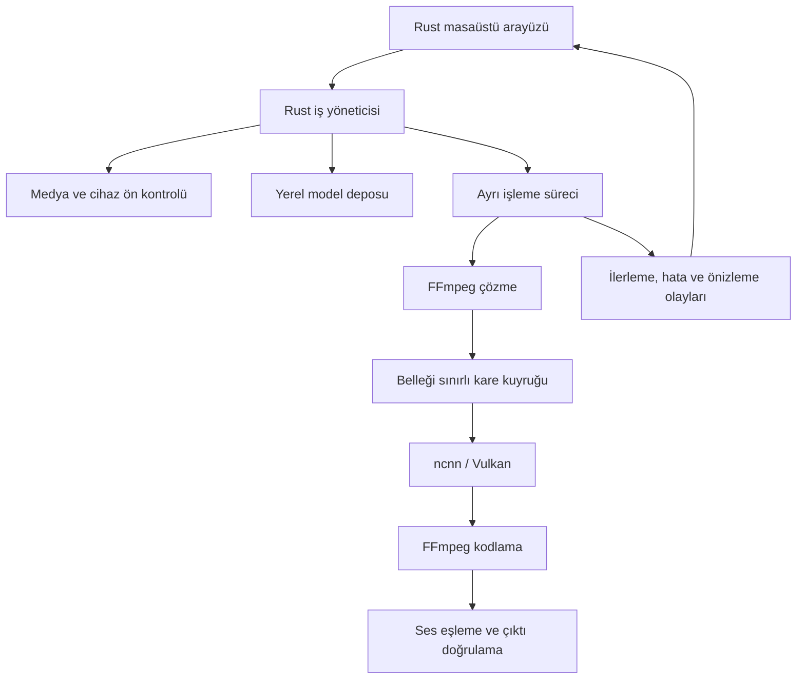

# Popy — Rust ile açık kaynak video iyileştirme uygulaması

Seçilen uygulama adı: **Popy**. Seçilen görsel kimlik: sade turuncu kırmızı panda yüzü. Marka kaydı ve logo dosyası `branding/` klasöründedir.

Uygulama aşamasında eklenen kullanıcı isteği: büyütmeyle birlikte açılıp kapanan otomatik renk ayarı. İlk teknik dilimde otomatik ton/kontrast ve hafif doygunluk olarak uygulandı; siyah beyaz AI renklendirmesi ayrı bir araştırma konusu.

Araştırma tarihi: 29 Ekim 2026. Güncel durum: Aşama 0 için Rust CLI ve ilk gerçek iGPU denemeleri tamamlandı; ayrıntılar [geliştirme durumunda](docs/STATUS.md). Kalite kapısı A ve sonraki aşamalar açık.

Bu belgede **doğrulanan bilgi** kaynakların söylediğini, **öneri** proje kararını, **ölçülecek** ise henüz kanıtlanmamış varsayımı ifade eder. Süreler geliştirme tahminidir. Kaynaklarda verilen model hızları bizim uygulamamızın performansı değildir.

## 1. Karar önerisi

Windows 11 x64 üzerinde çalışan, yerel işleme yapan, ana uygulaması Rust olan bir masaüstü ürünü geliştirmek uygulanabilir. Başlangıç hedefi: progresif SDR videoyu 2× büyütme, kısa bölümde önce/sonra karşılaştırması ve sesi korunmuş çıktı.

İlk motor **ncnn/Vulkan**, ilk model ailesi **Real-ESRGAN** olsun. Uygulama ve iş yöneticisi Rust; ncnn ve model uygulamaları gibi yerel bağımlılıklar C/C++ olabilir. Bu yaklaşım ana uygulamayı Rust ile geliştirme hedefini korur. Her bağımlılığı Rust'a yeniden yazmak kapsam dışıdır.

Arayüz önerisi **egui/eframe**: Rust ağırlıklı geliştirme, özel karşılaştırma görünümü ve tek dilde bakım. İşleme ayrı bir worker sürecinde çalışır. İlk araştırma prototipi mevcut komut satırı motorlarını kullanır; kullanılabilir alfa için kareleri diske dökmeyen worker köprüsü gerekir.

RTX 30/40/50 aileleri ana test hedefi; seçilmiş AMD kartları aynı temel motorda beta hedefi; modern iGPU'lar deneysel hedef. Tüm modellere ve bütün kartlara tek bir destek sözü verilmez.

**İlk yatırım kararı:** 20–35 saatlik teknik ve kalite denemesi. Bu kapı geçilmeden ayrıntılı arayüz, özel model eğitimi veya çoklu platform geliştirmesine girilmez.

## 2. Ürün sınırı ve kullanıcı problemi

Önerilen başlangıç problemi: Kullanıcı, kısa veya orta uzunluktaki düşük çözünürlüklü SDR videosunu, Python/CUDA ortamı kurmadan ve dosyasını sunucuya yüklemeden iyileştirebilsin; sonucu tüm videoyu işlemeden görebilsin.

İlk aday kullanıcılar: eski dijital çekimlerini iyileştiren kişiler, içerik üreticileri ve animasyon kullanıcıları. Bunlar hipotezdir; ilk haftada örnek videolar ve 5–8 kişiyle görüşme üzerinden birincil grup seçilir. Gerçek çekim için seçilen modelin animeye de uygun olduğu varsayılmaz.

Önerilen değerler:

- Hesap açmadan yerel işleme; ilk model indirmesinden sonra çevrimdışı kullanım.
- Az sayıda, test edilmiş model ve anlaşılır ayarlar.
- Aynı bölümün aynı ölçekte karşılaştırılması; yanıltıcı tek kare pazarlamasından kaçınma.
- GPU'nun gerçekten kullanıldığını, kalan süreyi ve bellek sınırını açık gösterme.
- Sorun çıktığında anlaşılır hata, korunmuş kaynak dosya ve temiz iptal.

Bu ürünün ilk iddiası Topaz'ın bütün modellerini ve profesyonel iş akışlarını karşılamak değildir. Topaz; iyileştirme, interpolasyon, stabilizasyon, SDR–HDR ve başka işlevler sunuyor. Eşdeğer kapsamı ilk sürüme koymak küçük ekip için gerçekçi değil. [Topaz hızlı başlangıç](https://docs.topazlabs.com/topaz-video/quick-start)

Güncel karşılaştırmalarda ürün sürümü yazılmalı: eski Video AI hattı ile güncel Topaz Video aynı ürün nesli değil. [Topaz ürün nesilleri](https://docs.topazlabs.com/topaz-video/tvai-vs-tv)

## 3. Rakipler ve yeniden kullanım kararı

| Proje | Doğrulanan durum | Bizim için anlamı |
|---|---|---|
| Video2X | C/C++ işlem hattı, Vulkan tabanlı model desteği, Windows/Linux ve masaüstü arayüzü; AGPL-3.0 | Teknik referans ve karşılaştırma tabanı. Yalnızca ücretsiz büyütme sunmak yeterli ayrışma sağlamaz. |
| QualityScaler | Windows, fotoğraf/video iyileştirme, tiling ve durdurma/devam özellikleri; depo lisansı MIT | Kolay kullanım, gizlilik ve düşük bellekle çalışma zaten mevcut beklentiler. |
| Topaz Video | Farklı sorunlara özel çok sayıda model ve geniş iş akışı | Genel kalite iddiası yerine seçilmiş senaryolarda karşılaştırılabilir sonuç hedeflenmeli. |

Kaynaklar: [Video2X](https://github.com/k4yt3x/video2x), [QualityScaler](https://github.com/Djdefrag/QualityScaler), [QualityScaler lisansı](https://github.com/Djdefrag/QualityScaler/blob/main/LICENSE), [Topaz iyileştirme modelleri](https://docs.topazlabs.com/topaz-video/filters/enhancement).

İki uygulama yolu var:

1. **Önerilen:** Kendi küçük Rust çekirdeğimiz; upstream ncnn/model kodları; FFmpeg. İş akışı üzerinde kontrol yüksek, bakım yükü de bize ait.
2. **Bütçe daralırsa alternatif:** Video2X üzerine katkı veya uygun lisansla entegrasyon. Daha az video motoru geliştirme işi olabilir; mevcut altyapıya ve lisansına uyum gerekir.

Video2X kodunu kopyalayıp farklı bir lisans altında bizimmiş gibi dağıtmak planın parçası değildir. Ayrı süreç kullanılması da tek başına lisans yükümlülüklerini ortadan kaldıran bir garanti sayılmaz. [Video2X lisansı](https://github.com/k4yt3x/video2x/blob/master/LICENSE)

**Devam koşulu:** Test kullanıcıları mevcut araçlara göre anlamlı bir kullanım kolaylığı farkı görmüyorsa, yeni ürün kapsamını büyütmek yerine mevcut projeye katkı seçeneği değerlendirilir.

## 4. Model araştırması ve seçim sırası

| Aday | Rol | Avantaj | Ana sınırlama | Önerilen aşama |
|---|---|---|---|---|
| Real-ESRGAN genel modelleri | Kare bazlı restorasyon/büyütme | Hazır ağırlıklar ve ncnn uygulaması | Hareket boyunca detay tutarlılığı garanti değil | İlk deneme ve v0.1 |
| Real-ESRGAN animevideo / Real-CUGAN | Animasyon | İçeriğe özel alternatifler | Gerçek çekimde genel çözüm kabul edilmemeli | Hedef kitle animeyse erken; aksi halde v0.2 |
| RIFE | Ara kare üretimi | Hazır Vulkan uygulaması | Sahne kesmesi, kapanma ve hızlı harekette hata | v0.2 |
| RealBasicVSR / BasicVSR++ | Zamansal bilgi kullanan restorasyon | Video odaklı karşılaştırma adayı | Dağıtım, operatör ve bellek karmaşıklığı | Araştırma hattı |
| FlashVSR / FlashVSR+ | Üretici video restorasyonu | Yeni kalite potansiyeli | Özel attention, CUDA ve dağıtım gereksinimleri | Ayrı deneysel kalite paketi |
| SeedVR2 | Üretici video restorasyonu | Daha güçlü restorasyon adayı | Resmî örnek hattı ağır; masaüstü paketleme ayrı çalışma | Sonraki araştırma |

**Real-ESRGAN:** Resmî depo Python ve taşınabilir ncnn seçeneklerini sunuyor. Kare bazlı hattı, videoya özel zamansal modeli varmış gibi anlatmamalıyız. Başlangıçta genel gerçek çekim için bir 2× ağırlık ve hafif genel model denenir; modelin gerçek çarpanı doğrulanır. Bir 4× modelden çıkan görüntüyü 2× boyuta küçültmek, gerçek 2× çıkarımla aynı maliyet değildir. Resmî ncnn uygulamasında tiling kaynaklı blok tutarsızlığı olabileceği de belirtiliyor. [Real-ESRGAN](https://github.com/xinntao/Real-ESRGAN)

**RIFE:** Practical-RIFE deposu eğitilmiş model bağlantılarının da depo ile aynı MIT lisansına tabi olduğunu belirtiyor. Ancak yeni Practical-RIFE ağırlıklarının seçtiğimiz ncnn sürümüne doğrudan uyduğu varsayılmaz; mimari ve dönüştürme uyumu ayrı doğrulanır. [Practical-RIFE](https://github.com/hzwer/Practical-RIFE), [RIFE ncnn](https://github.com/nihui/rife-ncnn-vulkan)

**Zamansal modeller:** BasicVSR++ ve RealBasicVSR, ikinci araştırma hattında kıyas adayıdır. Sentetik bozulmaya göre eğitilmiş benchmark modelinin gerçek telefon/YouTube sıkıştırmasında üstün olduğu sonucuna doğrudan varılamaz. [BasicVSR++ belgeleri](https://github.com/open-mmlab/mmagic/blob/main/configs/basicvsr_pp/README.md), [RealBasicVSR](https://github.com/ckkelvinchan/RealBasicVSR)

**FlashVSR ailesi:** İlk FlashVSR'nin resmî sparse-attention hattında RTX 40/50 uyumluluğu belirsiz olarak belirtiliyor. Daha yeni FlashVSR+ resmî deposu ise 24 GB RTX 4090 üzerinde 4K örneği bildiriyor; yayımlanan hat Linux ve CUDA istiyor. Bu, her RTX'te Windows desteği anlamına gelmez. Kod ve resmî model kartı Apache-2.0 gösteriyor. Yazarların donanım sonucu burada tarafımızca doğrulanmadı. [FlashVSR](https://github.com/OpenImagingLab/FlashVSR), [FlashVSR+](https://github.com/OpenImagingLab/FlashVSR_Plus), [resmî FlashVSR+ ağırlıkları](https://huggingface.co/ruchangyao/FlashVSR_plus)

**SeedVR2:** Resmî 3B model kartı Apache-2.0; ağır bozulma/büyük hareket ve aşırı detay üretme sınırlamalarını açıklıyor. Resmî depo yüksek bellekli H100 örnekleri veriyor. Topluluk optimizasyonlarının tüketici kartlarında çalışması mümkün olsa da bu araştırmada doğrulanmadı. Bu nedenle başlangıç tabanı değil. [SeedVR2 kodu](https://github.com/ByteDance-Seed/SeedVR), [3B model kartı](https://huggingface.co/ByteDance-Seed/SeedVR2-3B)

İlk hafta en fazla üç büyütme adayı denenir. Başlangıçta geniş model kataloğu toplamak yerine test edilmiş bir varsayılan seçilir. Üretici modellerin eklediği ayrıntı, kayıtta gerçekten var olan ayrıntının kanıtı olarak sunulmaz.

## 5. GPU desteği: çalışabilme, doğrulama ve performans ayrı

Aşağıdaki tablo bir **destek hedefidir**, yapılmış test sonucu değildir.

| Donanım | İlk motor | Sürüm hedefi | Yayın öncesi gereken |
|---|---|---|---|
| RTX 30 serisi | Vulkan; sonra CUDA/ORT değerlendirmesi | v0.1 ana hedef | En az bir düşük/orta bellekli temsilci |
| RTX 40 serisi | Vulkan; sonra hızlandırılmış RTX yolu | v0.1 ana hedef | Bir 8 GB sınıfı kart ve mümkünse yüksek bellekli kart |
| RTX 50 serisi | Vulkan; CUDA yolu ayrıca doğrulanır | v0.1 ana hedef | Gerçek Blackwell donanımında test |
| AMD RX 6000 / 7000 / 9000 aileleri | Vulkan | v0.1 beta; test edilen kartlar için | Her hedef mimariden erişilebilen temsilci ve güncel sürücü |
| Modern Intel/AMD iGPU | Vulkan küçük model ve küçük tile | v0.2 deneysel | Paylaşılan bellek, süre ve termal davranış ölçümü |
| Eski iGPU ve CPU | CPU tanılama / sınırlı deneme | İlk genel destek kapsamı dışında | Ayrı talep ve anlamlı performans varsa |

ncnn belgeleri NVIDIA/AMD/Intel için Vulkan yolları gösteriyor. Bu, belirli modelin her cihazda hızlı veya sorunsuz çalıştığını kanıtlamaz. [ncnn Vulkan belgesi](https://github.com/Tencent/ncnn/blob/master/docs/how-to-use-and-FAQ/FAQ-ncnn-vulkan.md)

NVIDIA'nın mimari tablosunda Blackwell'in ilk yerel CUDA desteği 12.8 ile belirtiliyor; PTX ile eski derlemelerin çalışabilmesi ayrı bir durum. Dolayısıyla RTX 30'da açılan eski bir CUDA paketini RTX 50 için test etmeden destekleniyor saymayız. [NVIDIA mimari tablosu](https://docs.nvidia.com/datacenter/tesla/drivers/cuda-toolkit-driver-and-architecture-matrix.html), [Blackwell uyumluluk rehberi](https://docs.nvidia.com/cuda/archive/12.8.1/blackwell-compatibility-guide/index.html)

Önerilen başlangıç cihaz hedefi: 16 GB RAM, SSD ve tercihen 8 GB ayrı GPU belleği. 4–6 GB kartlarda küçük tile ile çalışma araştırılır. Bunlar model testiyle güncellenecek hedeflerdir; gerçek minimum gereksinim açıklaması değildir. iGPU belleği ayrı VRAM gibi yorumlanmaz.

Uygulama başlangıçta kart adını, sürücüyü ve özellikleri okur; küçük gerçek model denemesi yapar. Destek durumu model bazında tutulur:

- Doğrulandı: belirli sürücü/model/uygulama sürümünde test edildi.
- Deneysel: temel deneme geçti; uzun iş testi eksik.
- Uygun değil: gerekli özellik, bellek veya doğruluk denemesi başarısız.

Birden fazla GPU varsa yalnızca GPU 0 seçilmez; dizüstünde bu iGPU olabilir. Kullanıcı cihazı seçebilir. AI hızlandırma ve video kodlayıcı desteği ayrı test edilir; birinin çalışması diğerini garanti etmez.

## 6. Çıkarım motoru seçenekleri

| Seçenek | Güçlü taraf | Maliyeti | Karar |
|---|---|---|---|
| ncnn + Vulkan | Geniş üretici kapsaması, hazır ESRGAN/RIFE uygulamaları | Rust–C/C++ köprüsü; model dönüşüm ve shader testi | İlk sürüm |
| ONNX Runtime + ort | Rust API'si ve farklı hızlandırıcılar | ONNX operatör/şekil uyumu, DLL ve paketleme | İkinci motor adayı |
| Windows ML | Windows'ta üreticiye özel EP dağıtımı | Rust entegrasyonu ve OS/sürücü matrisi | Windows optimizasyon araştırması |
| Python/PyTorch worker | Yeni araştırma modellerine yakınlık | Büyük paket ve CUDA/bağımlılık bakımı | İsteğe bağlı deneysel paket |
| Kendi Rust GPU motorumuz | Tam kontrol | Gereksiz kernel, operatör ve bakım yükü | Başlangıçta yapılmaz |

ort, ONNX Runtime için bağımsız bir Rust sarmalayıcısı; sağlayıcı kurulamadığında sessiz CPU dönüşü olabiliyor. GPU seçilmişse hata görünür olmalı; operatörlerin kısmi CPU çalışması da profille kontrol edilmeli. [ort sağlayıcı belgeleri](https://github.com/pykeio/ort/blob/main/docs/content/perf/execution-providers.mdx)

Önceki konuşmadaki DirectML önerisine güncel ek: DirectML desteklenmeye devam ediyor ancak geliştirme odağı Windows ML'ye taşınmış. DirectML bu nedenle tek uzun vadeli motor olarak seçilmiyor. Windows ML'deki üretici EP'leri ayrıca Windows 11 24H2+ ve donanım/sürücü şartlarına bağlı. Yeni deneysel Windows ML Runtime API ile desteklenen ONNX Runtime/EP dağıtım yolunu birbirine karıştırmamalıyız. [DirectML durumu](https://learn.microsoft.com/en-us/windows/ai/directml/dml-get-started), [Windows ML EP'leri](https://learn.microsoft.com/en-us/windows/ai/new-windows-ml/supported-execution-providers), [deneysel Runtime API](https://learn.microsoft.com/en-us/windows/ai/new-windows-ml/runtime/overview)

ONNX seçeneği için teknik kapı: sabit model ağırlığı ve örnek girdilerde referans sonuçla karşılaştırma; sonra hedef GPU'da hız/bellek/paket boyutu. Real-ESRGAN'ın resmî export scripti belirli 4× RRDB yapısına göre yazılmış; bütün model ailesini otomatik dönüştüren çözüm değil. [Export scripti](https://github.com/xinntao/Real-ESRGAN/blob/master/scripts/pytorch2onnx.py)

## 7. Rust uygulama mimarisi

Bu diyagram planlanan mimaridir. Motor denemesi geçmeden kod yapısı kesinleştirilmez.

**Arayüz:** egui/eframe ile dosya seçimi, karşılaştırma görüntüsü, ayarlar ve kuyruk. egui belgeleri ağır işleri arayüz döngüsü dışında çalıştırmayı ve kanal üzerinden haberleşmeyi öneriyor. Hazır tam video oynatıcısı varmış gibi davranmayız; ilk önizleme seçilmiş kare ve kısa bölüm üzerindedir. [egui](https://github.com/emilk/egui)

**Alternatif arayüz:** Tauri v2, web teknolojileriyle ayrıntılı tasarım istenirse uygun aday. Rust backend korunur, frontend ayrı teknoloji olur. Yan süreç paketleme desteği mevcut; fakat büyük ham kareleri JSON/base64 üzerinden frontend'e taşımak uygun veri yolu sayılmaz. Arayüz seçimi kalite denemesinden sonra kısa bir görsel prototiple sabitlenir. Varsayılan öneri egui; tam ürün çıkmadan iki arayüz birden tutulmaz. [Tauri sidecar](https://v2.tauri.app/develop/sidecar/)

**Worker:** İlk spike mevcut CLI araçlarını kısa kare dizileriyle çağırır. Alfa sürümünde Rust worker, dar C ABI üzerinden ncnn/model C++ uygulamasını çağırır. Köprü yalnızca model yükleme, cihaz sorgusu, kare işleme ve kaynak bırakmayı kapsar; video zamanlaması Rust/media katmanında kalır. Native çökme arayüzü düşürmez; sürücü kaynaklı sistem sorununun süreç izolasyonuyla tamamen önleneceği söylenmez.

**Medya katmanı:** İlk alfa için FFmpeg/ffprobe ayrı süreçleri ve ham kare pipe'ları. Bunlar çalışan uygulamanın kullandığı alt araçlardır; kullanıcıya terminal kurulumu yaptırılmaz. Her kare için süreç açılmaz; model bir iş boyunca bellekte tutulur. Ham kareler kontrol mesajlarıyla aynı kanaldan gönderilmez. Süreçlerin stdout/stderr akışları birlikte tüketilir; tıkanma ve iptal senaryoları test edilir.

**İş durumları:** Bekliyor → hazırlanıyor → işleniyor → sonlandırılıyor → doğrulanıyor → tamamlandı. Hata ve iptal ayrı son durumlardır. İlerleme yalnızca kodlayıcının yüzdesinden türetilmez; hazırlık/model yükleme süreleri görünür olur. [FFmpeg ilerleme arayüzü](https://www.ffmpeg.org/ffmpeg.html)

**Planlanan modüller:** app-ui, core-jobs, media, model-store, worker, backend-ncnn, benchmark. Bunlar şimdilik klasör oluşturma talimatı değil; sorumluluk sınırlarıdır. Başlangıçta gereksiz genel eklenti sistemi kurulmaz.

## 8. Video doğruluğu: ilk sürümün dar sözleşmesi

v0.1 destek hedefi:

- Windows 11 x64.
- Tek video akışı, progresif, 8-bit SDR BT.709, doğrulanmış sabit kare hızı.
- İlk giriş kombinasyonu H.264 + AAC / MP4; ikinci kombinasyonlar ayrı testle eklenir.
- 2× büyütme; toplam çıktı en fazla 3840×2160 sınırı. Daha büyük veya tek boyutu sınırı aşan çıktı açık hata alır.
- Kaynak kare hızı rasyonel biçimde korunur: 30000/1001, 30'a yuvarlanmaz.
- Tek ses akışı; uygun AAC sesini kopyalama; başlangıç ofseti ve süre doğrulaması.
- Kaynak dosya üzerine yazılmaz. Çıktı önce geçici ada yazılır; doğrulanınca son ada taşınır.

HDR/HLG/Dolby Vision, 10-bit, interlaced kaynak, değişken kare hızı, çoklu video/ses akışı ve karmaşık profesyonel formatlar ilk alfanın garantili kapsamı dışındadır. Girdi profili destek dışındaysa işlem başlamadan anlaşılır açıklama gösterilir. HDR'ı sessizce SDR'a veya VFR'ı sessizce CFR'a çevirmek kabul edilmez.

Ham RGB pipe tek başına kare zaman damgalarını taşımaz. Bu yüzden başlangıç hattı sadece doğrulanmış CFR girdiye söz verir. VFR algısı yalnızca avg_frame_rate ile r_frame_rate eşitliğine bırakılmaz; kare zaman damgaları incelenir. VFR ve tam zaman damgası koruması eklenirken paketli IPC veya libav tabanlı okuma/yazma yolu değerlendirilir. [FFmpeg zamanlama seçenekleri](https://ffmpeg.org/ffmpeg.html)

Renk doğruluğu için dönüşüm aralığı, matris, etiketler ve BT.709 test desenleri denetlenir. Yalnızca çıktı metadata'sını kaynakla aynı yazmak yeterli sayılmaz. SAR/DAR ve rotasyon doğru uygulanır veya karmaşık örnek açıkça reddedilir. Önizleme ve çıktı aynı işleme ayarlarını kullanır; önizleme görüntüsünün ekran için küçültülmesi dosya kalitesi olarak sunulmaz.

Gürültü azaltma ve keskinleştirme için evrensel bir güç kaydırıcısı taklit edilmez. Her kontrol seçilen modelin gerçekten desteklediği parametreye karşılık gelir. Orijinalle karıştırma kullanılacaksa aynı geometri ve uygun renk uzayı doğrulanır.

## 9. Bellek, disk, hız ve tiling

3840×2160 RGB8 tek kare yaklaşık 24,9 MB. 30 FPS bir dakikalık ham çıktı yaklaşık 44,8 GB eder; tensorlar ve giriş kareleri buna dahil değildir. Bu hesap, uzun videoyu topluca PNG'ye çıkaran ilk prototip yönteminin ürün mimarisi olarak neden uygun olmadığını gösterir. PNG boyutları içeriğe göre değişir; bu sayı PNG dosya boyutu tahmini değildir.

Ürün hattı:

1. Küçük, boyutu byte ile sınırlandırılmış kare kuyruğu.
2. Küçük batch ve tek GPU üzerinde tek etkin iş.
3. Model/cihaz için başlangıç tile denemesi; bindirmeli kenarların doğru kırpılması.
4. Yetersiz bellekte sınırlı sayıda daha küçük tile ile yeniden deneme.
5. Bellek hatası sonrası model durumunu temizleyip gerekirse worker'ı yeniden başlatma.
6. Karşılaştırma için aynı tile planını koruma; tile değişikliğinin sonuç etkisini kaydetme.

Tile küçültmek her modeli çalıştırmaz. Zamansal modellerde durum belleği ve üretici modellerde attention/decoder belleği ayrıca sınırlayıcıdır. RIFE'a görüntü büyütmedeki tiling yaklaşımı doğrudan uygulanmaz.

İlk sürümde CPU–GPU kopyaları olabilir; sıfır kopya hattı ön koşul yapılmaz. Önce çözme, dönüşüm, aktarım, AI, kodlama ve disk süreleri ayrı ölçülür. Darboğaz kanıtlanınca o parça optimize edilir. Donanım kodlama, AI çıkarımını hızlandırmış sayılmaz.

Kullanıcıya gösterilen süre, ısınma/model yükleme sonrasındaki gerçek iş hızından hesaplanır ve belirsizlik payı içerir. Örnek hesap: 10 dakika × 30 FPS = 18.000 giriş karesi; tüm hattın hızı 5 giriş karesi/sn ise yaklaşık 60 dakika, 20 ise 15 dakika. Bunlar ölçülmüş uygulama hızları değildir; ilk yükleme ve sonlandırma ayrıca zaman alır.

## 10. v0.1 kullanıcı deneyimi

Ana akış: Video seç → hedef boyutu seç → kısa bölümde dene → sonucu karşılaştır → dışa aktar.

- Orta alan: önce/sonra sürgüsü ve aynı büyütmede inceleme.
- Sağ panel: profil, hedef çözünürlük, çıktı kalitesi, seçili cihaz.
- Alt alan: küçük zaman çizgisi; önce tek kare, ardından 3–5 saniyelik bölüm denemesi.
- Kuyruk: dosya adı, durum, ölçülen hız, tahmini kalan süre, iptal.
- İlk kullanım: GPU kontrolü ve tek önerilen modeli boyutu göstererek indirme.

İlk alfa önizlemesinde sesli tam video oynatma zorunlu değil; kısa önizleme karelerinin oynatılması ve kare kare inceleme yeterli olabilir. Bunun kabul edilebilirliği kullanıcı testinde doğrulanır. Dosya dışa aktarmada ses korunur.

Model adları gelişmiş ayrıntıda gösterilebilir; kullanıcıdan onlarca araştırma modelini tanıması beklenmez. İlk ekranda 1–2 doğrulanmış profil bulunur. UI tasarımına geçmeden görsel hiyerarşi, okunabilir hata mesajları ve gerçek örnek video ile kullanım denemesi yapılır.

v0.1'de anında duraklat/devam vaadi yok: iptal güvenli çalışır. Kalıcı checkpoint ve yeniden başlatma v0.2'de ayrı tasarlanır; bozuk MP4'e kaldığı yerden yazma yaklaşımı kullanılmaz.

## 11. Kalite ve performans doğrulama planı

**Başlangıç seti:** 15 adet 8–15 saniyelik, kullanım hakkı belli klip. Her kategoriden üç örnek: yüz/saç, ince doku, kamera/hızlı hareket, düşük ışık/sıkıştırma, animasyon/yazı. Birincil hedef seçilince ana kalite puanı o grupta tutulur; diğer gruplar stres testi olur. İnterlaced eski kayıtlar destek dışı algısını test etmek için ayrıca eklenir.

**Karşılaştırmalar:** Aynı hedef çözünürlükte Lanczos; seçilen ncnn modelleri; Video2X'in aynı modelle sonucu. Topaz kıyası ancak erişilebilir ve kullanımına yetkili olduğumuz kurulumda yapılır; satın alma bu planın verdiği bir yetki değildir. Topaz yoksa karşılaştırmanın yapılmadığı rapora yazılır.

**Adil ölçüm:** Aynı giriş, aynı kırpma, aynı çıktı boyutu ve mümkün olduğunca aynı kodlama. Model çıktısının kodlama öncesi incelemesi ile son kullanıcı çıktısının incelemesi ayrılır. Isınma, model indirme ve yükleme ilk çalıştırma maliyeti olarak ayrıca raporlanır.

| Alan | Ölçüm | Kabul önerisi |
|---|---|---|
| Algılanan kalite | Etiketsiz A/B; normal hız ve aynı zoom | Hedef kliplerde en az %60 tercih; küçük örneklem olduğu belirtilir |
| Zamansal tutarlılık | Doku titremesi, yüz değişimi, halo, ghosting | Kritik kusur olan profiller varsayılan olamaz |
| Doğruluk | Kare sayısı, zaman damgası, ses ofseti, renk/desen | Desteklenen girdide açıklanamayan kare kaybı/renk dönüşümü yok |
| Ses | Baş/orta/son test işaretleri | Eklenen kayma hedefi ≤20 ms; test düzeneğiyle doğrulanır |
| Dayanıklılık | 10 kısa iş kuyruğu + 30 dakikalık kaynak | Çökme/bozuk tamamlandı çıktısı yok; bellek süreyle sürekli büyümez |
| Kullanım | 5 kişiyle kurulum, önizleme, çıktı | En az 4 kişi geliştirici yardımı olmadan tamamlar |
| Performans | Uçtan uca giriş karesi/sn, model süresi, tepe RAM/VRAM | GPU başına ölçüm yayınlanır; başlangıçta sabit FPS sözü verilmez |

Bunlar önerilen yayın kapılarıdır; test edilmiş sonuçlar değildir. Küçük A/B çalışmasından istatistiksel pazar üstünlüğü iddiası çıkarılmaz.

PSNR/SSIM yalnızca gerçek yüksek kaliteli referans bulunan, zaman ve geometri olarak eşlenmiş örneklerde yardımcı ölçüm. Referans yoksa kaynak videoyu mutlak doğruluk kabul ederek kalite skoru üretmeyiz. VMAF da tek başarı ölçütü olmaz; Netflix'in belgeleri görüntü iyileştirme işlemlerinin skorları etkileyebildiğini ve ölçüm varsayımlarının önemli olduğunu açıklıyor. [VMAF](https://github.com/Netflix/vmaf), [VMAF SSS](https://github.com/Netflix/vmaf/blob/master/resource/doc/faq.md)

Benchmark kaydı şu alanları içerir: kaynak hash'i ve kullanım hakkı, çözünürlük/fps/renk, GPU/sürücü, OS, uygulama ve motor sürümü, model hash'i, tile/batch/hassasiyet, encoder ayarı, yükleme/işleme/sonlandırma süresi, tepe bellek ve hata. Optimizasyon sonrası aynı set yeniden karşılaştırılır.

## 12. Lisans, model kaynağı ve yayınlama

Yeni Popy Rust kodu için plandaki Apache-2.0 tercihiyle LICENSE oluşturuldu. Üçüncü taraf kod ve ağırlıkların lisansları bundan bağımsızdır; onlara Popy'nin lisansı uygulanmaz.

| Bileşen | Kontrol edilen lisans bilgisi | Yapılacak |
|---|---|---|
| Real-ESRGAN kodu | BSD-3-Clause | Kaynak/bildirimleri koru; seçilen ağırlığın kapsamını ayrıca belgele |
| Real-ESRGAN ncnn uygulaması | MIT | Upstream ve temel aldığı kodun bildirimlerini koru |
| ncnn | BSD-3-Clause + belirtilen üçüncü taraflar | Sabitlenmiş derlemenin bildirimlerini paketle |
| RIFE ncnn | MIT | Seçili ağırlık ve dönüşümün kaynağını kaydet |
| Practical-RIFE | MIT; ağırlık bağlantıları için de açık beyan | Seçilen sürümün beyanını arşivle |
| RealBasicVSR kodu | Apache-2.0 | Ağırlık ve bağımlılıkları ayrıca incele |
| FlashVSR+ kod/model kartı | Apache-2.0 | Decoder ve türetilen model bileşenlerinin zincirini kaydet |
| SeedVR2-3B model kartı | Apache-2.0 | Seçilecek gerçek dosya/revizyonu sabitle |
| Video2X | AGPL-3.0 | Kullanım/entegrasyon kararını bununla uyumlu ver |
| FFmpeg | Derleme seçeneklerine bağlı LGPL/GPL | Tam yapılandırma, kaynak sürümü ve dağıtım yükümlülükleri kaydı |

Doğrudan lisans kaynakları: [Real-ESRGAN](https://github.com/xinntao/Real-ESRGAN/blob/master/LICENSE), [ncnn uygulaması](https://github.com/xinntao/Real-ESRGAN-ncnn-vulkan/blob/master/LICENSE), [ncnn](https://github.com/Tencent/ncnn/blob/master/LICENSE.txt), [RIFE ncnn](https://github.com/nihui/rife-ncnn-vulkan/blob/master/LICENSE), [RealBasicVSR](https://github.com/ckkelvinchan/RealBasicVSR/blob/master/LICENSE), [FFmpeg](https://ffmpeg.org/legal.html).

Model indirmesinin uygulama dışında yapılması lisans yükümlülüklerini otomatik olarak çözmez. Katalog girişi için kod lisansı, ağırlık lisansı, kaynak URL, revizyon, hash ve yeniden dağıtım koşulları ayrı alanlardır. Belirsiz ağırlık varsayılan paket olamaz. Sadece depo ana sayfasındaki lisans etiketi bütün türevler için yeterli kanıt sayılmaz.

FFmpeg için başlangıç değerlendirmesi: GPL/nonfree bileşenleri açılmadan uygun derleme ve lisansı doğrulanmış encoder seçimi. Yazılım x264 kullanımı gibi tercihler derleme lisansını etkiler. Açık kaynak ürün olmak uyum yükümlülüklerini kaldırmaz; dağıtılan derlemenin kaynak ve bildirimleri sağlanır. Bu bölüm dağıtım öncesi uyum incelemesinin yerini alan hukuki onay değildir. [FFmpeg lisans açıklaması](https://ffmpeg.org/legal.html)

## 13. Güvenlik ve sürdürülebilir bakım

- Uygulama videoyu dış servise göndermez. Model indirme ve güncelleme ağ işlemleri ayrı ve görünürdür.
- Hash dosya bütünlüğünü doğrular; yayıncının kimliğini tek başına doğrulamaz. Katalog ve güncelleme doğrulaması ayrıca tasarlanır.
- Model kataloğu sabitlenmiş, incelenmiş kaynaklardan gelir; ilk sürüm rastgele eklenti kodu veya pickle model çalıştırmaz.
- Dosya adları shell komutuna birleştirilmez; yapılandırılmış argümanlarla süreç çağrılır. Türkçe/Unicode, boşluk ve uzun yol örnekleri test edilir.
- Kaynak korunur; kullanıcı dosyaları yerine yalnızca uygulamanın kendi iş klasörleri temizlenir. Disk dolması hata olarak ele alınır.
- Loglar varsayılan yereldir; dosya yolları ve kişisel içerik destek raporunda kullanıcının kontrolündedir. Telemetri varsayılan kapalı önerilir.
- Native motor ve FFmpeg sürümleri sabitlenir; kaynak derleme tarifi ve bağımlılık listesi tutulur. Güvenlik düzeltmeleri takip edilen bakım işidir; arka planda otomatik takip kurulmuş sayılmaz.
- İlk yayın portable paket olabilir. İmzalama/installer maliyeti öğrenilir; kullanıcı izni olmadan ödeme yapılmaz. İmzasız paketlerin kullanıcı kurulumuna etkisi test edilir.

## 14. Aşamalı geliştirme ve teslim koşulları

### Aşama 0 — Kalite ve donanım denemesi, 20–35 saat

Çıktı: 15 kliplik set, 2–3 model karşılaştırması, çalışan kısa CLI zinciri, ilk GPU raporu ve model/lisans envanteri.

Önce Lanczos karşılaştırması; ardından ncnn ile 2× model ve hafif aday. Kısa klipte geçici kare dosyaları kullanılabilir. En az bir RTX üzerinde gerçek deneme gerekir; AMD/RTX 50 erişimi yoksa destek boşluğu açıkça kalır.

**Kapı A:** Hedef içerikte görünür fayda, kritik temporal kusurları yönetilebilir profil, lisansı belgelenecek ağırlık ve pratik işlem süresi. Bunlar yoksa model/hedef içerik değişir; arayüze geçilmez.

### Aşama 1 — Akış halinde Rust motoru, 45–70 saat

Çıktı: Tek komutla desteklenen videoyu işleyen Rust CLI ve ayrı worker; ham kare akışı; sınırlı bellek; model yükleme; güvenli iptal; çıktı doğrulama.

İş: FFmpeg süreç yönetimi, dar ncnn köprüsü, CFR sözleşmesi, renk dönüşümü, AAC ses eşleme, tile/OOM yönetimi ve iş durumu.

**Kapı B:** Uzun işte sınırlı bellek; doğru kare sayısı/süre/ses; iptal sonrası kaynak ve çıktı güvenliği. Yerel köprü bütçeyi aşarsa Video2X tabanlı alternatifin toplam maliyeti yeniden hesaplanır.

### Aşama 2 — Masaüstü arayüzü, 30–50 saat

Çıktı: Dosya açma, tek profil, 2× hedef, kare karşılaştırması, kısa bölüm önizlemesi, kuyruk ve hata ekranı.

**Kapı C:** 5 kullanıcının en az 4'ü kurulum → önizleme → çıktı akışını geliştirici yardımı almadan bitirir. Gerekirse tam kısa klip oynatıcısı burada kapsamlandırılır.

### Aşama 3 — Uyum ve paketleme, 40–65 saat

Çıktı: Temiz Windows makinesinde çalışan paket, model yöneticisi, GPU kontrolü, lisans bildirimleri, sorun giderme ve benchmark raporu.

**Kapı D:** İddia edilen her GPU ailesi için gerçek test veya açık deneysel etiketi; eksik runtime olmadan kurulum; hatalı model indirmesi/disk dolması/worker çökmesi senaryoları.

### Aşama 4 — Sınırlı alfa, 20–35 saat

Çıktı: 5–8 kullanıcıyla geri bildirim, hata önceliklendirme, örnek videolar ve sürüm notları. Yayınlama ve dışarıya mesaj gönderme, uygulama geliştirmesinden ayrı yetki adımıdır; bu araştırmada yapılmadı.

**Kapı E:** Kritik veri/çıktı bozulması hatası yok; kullanıcıların gerçek kaynaklarında seçilmiş modelin faydası sürüyor. Sonrasında herkese açık sürüm değerlendirilir.

## 15. Emek, zaman ve maliyet tahmini

Aşamaların toplamı 155–255 saat; yaklaşık %25 entegrasyon payıyla **200–320 odaklı saat** planlama aralığı. Bu süre eğitim, yeni model geliştirme veya bütün GPU'ları satın almayı kapsamaz. İş akışına yabancılık ve donanıma erişim süresi aralığı büyütebilir.

| Haftalık odaklı süre | Yaklaşık takvim |
|---|---|
| 30 saat | 7–11 hafta |
| 15 saat | 13–22 hafta |
| 10 saat | 20–32 hafta |

Bu bir teslim taahhüdü değil. Özellikle native köprü, video zamanlaması ve gerçek donanım testi tahmini etkiler. İlk 20–35 saatlik kapı sonunda kalan emek yeniden hesaplanır. AI ile kod yazılması bu doğrulama sürelerini ortadan kaldırmaz.

Başlangıçta GPU kiralama veya model eğitimi gerekmez; mevcut erişilebilir kartlarla deneme yapılır. Sonraki maliyetler: farklı GPU'lara test erişimi, dağıtım bant genişliği, gerekiyorsa kod imzalama ve sınırlı araştırma GPU zamanı. Güncel fiyat teklifi alınmadığı için para tutarı verilmedi; satın alma/kiralama yapılmadı.

## 16. Sonraki sürümler

**v0.2:** Sahne kesmesi kontrolüyle 2× FPS RIFE; açık VFR normalleştirme akışı veya zaman damgası koruyan medya katmanı; checkpoint ile devam; ikinci içerik profili; iGPU denemeleri. FPS artırma ile restorasyon sırası aynı set üzerinde karşılaştırılır, tek sıra evrensel doğru kabul edilmez. Sesli normal hız dönüşümü ile ağır çekimin ses davranışı ayrı tanımlanır.

**v0.3:** Ölçümle haklı çıkarsa RTX için ORT/CUDA veya Windows ML motoru, encoder seçenekleri, Linux fizibilitesi. Model hash'i ve backend'e bağlı önbellek; yeni sürümde eski derlenmiş engine dosyaları körlemesine kullanılmaz.

**Deneysel kalite hattı:** FlashVSR+ ve SeedVR2, ayrı kurulum/paket ve açık destek koşullarıyla değerlendirilir. İlk adım kendi modellerini Rust'a port etmek değil, resmî sonucu yeniden üretip kalite ve bellek bedelini ölçmektir. Tüketici Windows dağıtımı kanıtlanmadan ana ürüne alınmaz.

**Ertelenenler:** Kendi temel modelimizi eğitmek, bulut işleme, çoklu GPU aynı iş, NPU desteği, video editörü/timeline, plugin mağazası, yüz kimliği yeniden üretme, stabilizasyon, deinterlace ve HDR iş akışı. Her biri kullanıcı talebi ve bakım maliyetiyle ayrıca değerlendirilir.

## 17. Riskler ve vazgeçme / yön değiştirme eşikleri

| Risk | Erken işaret | Karşılık |
|---|---|---|
| Görüntü daha keskin ama hareketli görüntü kötü | Doku/facial titreme | Varsayılan modeli değiştir; hedef içeriği daralt; zamansal modeli araştır |
| Basit rakiplerden fark çıkmıyor | Kullanıcılar mevcut aracı tercih ediyor | Yeni ürün yerine katkı/entegrasyon seçeneğini seç |
| Donanım kapsamı bakım yükünü patlatıyor | GPU/sürücüye özel sürekli hata | Destek matrisini daralt; deneysel etiket; tek temel motor |
| Paketleme geliştirmeyi yutuyor | Kullanıcıya CUDA/Python kurdurma ihtiyacı | Vulkan temel paketini koru; ağır kalite paketini ayır |
| Video doğruluğu bozuluyor | Ses kayması, renk değişimi, kare kaybı | Yeni özellikleri durdur; medya sözleşmesini düzeltmeden yayınlama |
| Süre uzuyor | Kapı A/B planı ciddi aşıyor | Kapsam daralt veya mevcut motor kullan; tek dil saflığı uğruna yeniden yazma |
| Model lisansı belirsiz | Ağırlık kaynağı/revizyonu bulunamıyor | Modeli varsayılan katalogdan çıkar |

## 18. İlk 10 iş günü için somut sıra

Bu sıra yaklaşık 30–45 odaklı saat varsayar; iş günlerinin her biri tam gün çalışma anlamına gelmez.

1. Üç kullanım grubundan örnekler topla; birincil kalite hedefini ve desteklenecek girdi sözleşmesini seç.
2. 15 kısa klibi hak bilgileri/hash ve teknik özelliklerle kayıt altına al.
3. Lanczos tabanını üret; iki genel model ve gerekliyse bir anime adayını dene.
4. Tiling, gerçek 2×/4× maliyeti ve hareketli sonuçları karşılaştır.
5. RTX üzerinde uçtan uca süre ve bellek raporu çıkar; erişilebilen AMD/iGPU'da küçük test yap.
6. Ağırlık/uygulama/motor lisans zincirini kaydet; belirsiz modeli ele.
7. Kapı A kararını ver: devam, içerik/model değişimi veya mevcut projeye katkı.
8. Devam ediliyorsa kısa Rust CLI zincirini ve iptali kur.
9. Dar worker köprüsünün tek kare / ardışık kare denemesini yap; tam videoda bellek akışını tasarla.
10. egui/eframe karşılaştırma ekranı için küçük görsel prototip hazırla; kalan takvimi ölçümlere göre güncelle.

Bu belgenin önerdiği ilk uygulama çıktısı: bir kısa videonun, gerçek modelle ve kayıtlı ayarlarla işlenmiş sonucu + tekrar edilebilir kalite/hız raporu. Tam uygulama geliştirmesine geçiş bunun üzerinden değerlendirilir.
